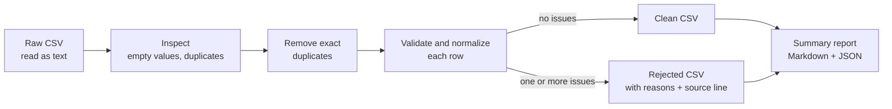

# Python Data Processing — Support Ticket Cleaning Pipeline

[](https://github.com/IvanRHG/python-data-processing/actions/workflows/tests.yml)

A small, reproducible Python workflow that takes a messy CSV export, finds its quality problems, and produces a clean dataset, a table of rejected rows with reasons, and a summary report.

> **Project type:** personal, demonstrative project. All data is **synthetic** (generated from a fixed random seed). It does not describe any real company, customer, or ticket.

## Problem

Operational data exported by hand or from several tools is rarely ready for analysis. Typical problems:

- the same value written in different ways (`"Español"`, `"ES"`, `" spanish "`)
- missing values in fields that are required
- impossible values (a date of `2026-13-02`, a satisfaction score of `7`, negative hours)
- records exported twice, or the same ID with conflicting content

If these problems are fixed silently, or by guessing, the analysis becomes unreliable and nobody can trace what changed.

## Objectives

1. Load and inspect the raw file before changing anything.
2. Normalize text to a single canonical spelling, using explicit mapping tables only.
3. Validate types and allowed values for every row.
4. Separate valid rows from rows that need human review, keeping the reason for each rejection.
5. Produce a short report and export everything in open formats (CSV, JSON, Markdown).
6. Make the whole process reproducible and covered by tests.

## Methodology



| Rule | Decision | Rationale |
|---|---|---|
| Exact duplicate rows | Keep the first, drop the rest, count them | Same record exported twice; no information is lost |
| Same `ticket_id`, different content | **Reject every copy** | There is no way to know which version is correct |
| Missing `ticket_id`, `created_at`, `language`, or `category` | Reject | The row cannot be used without them |
| Missing `country`, `satisfaction_score`, `resolution_hours` | Keep as empty | Optional fields (for example, a customer who did not answer the survey) |
| Known spelling variant (`"live chat"`, `"Inglés"`) | Map to canonical value (`chat`, `en`) | Defined in [`ticket_pipeline/schema.py`](ticket_pipeline/schema.py) |
| Unknown value (`"Portuguese"`, `"refund??"`) | Reject | Values are never invented or guessed |
| Dates | Accept `YYYY-MM-DD` and `YYYY/MM/DD` only | Formats like `05/03/2026` are ambiguous (May 3 or March 5?) |
| `satisfaction_score` | Integer from 1 to 5 | Values outside the scale are entry errors |
| `resolution_hours` | Number ≥ 0 | Negative durations are impossible |

Every value is read as text first and converted explicitly. That way an invalid value is **reported** instead of silently turning into `NaN`.

## Results on the sample data

Running the pipeline on [`data/raw/support_tickets_raw.csv`](data/raw/support_tickets_raw.csv):

| Step | Rows |
|---|---:|
| Input | 114 |
| Exact duplicates removed | 3 |
| Rejected for review | 12 |
| **Clean output** | **99** |

Full report: [`data/processed/summary_report.md`](data/processed/summary_report.md). Example of rejected rows ([`rejected_rows.csv`](data/processed/rejected_rows.csv)):

| source_row | ticket_id | raw value that failed | rejection_reasons |
|---:|---|---|---|
| 16 | TCK-0022 | `resolution_hours = -4.0` | `negative_resolution_hours` |
| 69 | TCK-0061 | `created_at = yesterday` | `invalid_created_at` |
| 96 | TCK-0046 | `satisfaction_score = 7` | `satisfaction_score_out_of_range` |
| 65, 112 | TCK-0016 | priority `HIGH` vs `low`, hours `14.0` vs `99.0` | `conflicting_ticket_id` |

`source_row` is the line number in the raw CSV, so a reviewer can go straight to the original record.

## Project structure

```text
python-data-processing/
├── data/
│   ├── raw/support_tickets_raw.csv        # synthetic input (with injected problems)
│   └── processed/                         # outputs, committed so results can be inspected
│       ├── support_tickets_clean.csv
│       ├── rejected_rows.csv
│       ├── summary_report.md
│       └── summary_report.json
├── scripts/generate_sample_data.py        # regenerates the raw CSV (seed 2026)
├── ticket_pipeline/
│   ├── schema.py                          # columns, allowed values, synonym maps
│   ├── cleaning.py                        # load, inspect, validate, clean
│   └── report.py                          # summary and export
├── tests/test_pipeline.py                 # 24 tests (pytest)
├── run_pipeline.py                        # command-line entry point
└── requirements.txt
```

## Usage

Requires Python 3.10+.

```bash
git clone https://github.com/IvanRHG/python-data-processing.git
cd python-data-processing
python -m venv .venv
# Windows: .venv\Scripts\activate    macOS/Linux: source .venv/bin/activate
pip install -r requirements.txt

python run_pipeline.py                       # uses data/raw → data/processed
python run_pipeline.py --input my.csv --output-dir out/
python -m pytest                             # run the tests
python scripts/generate_sample_data.py      # optional: rebuild the sample input
```

Expected console output:

```text
Read 114 rows | removed 3 exact duplicates | rejected 12 | clean 99
```

If the input file is missing, empty, not UTF-8, or lacks required columns, the program prints a clear `ERROR:` message and exits with code `1` instead of showing a stack trace.

## Tests

`tests/test_pipeline.py` covers the value helpers, each rejection rule, duplicate handling, error handling, the CLI exit code, and a check that the committed sample still produces the numbers documented above.

## Technologies

Python 3 · pandas · pytest · Mermaid (diagram)

## Limitations

- Validation rules are written for this one dataset. A new dataset needs its own `schema.py`.
- Country names are only trimmed and title-cased, not checked against an official list.
- Rejected rows are not corrected automatically. That is a deliberate choice, but it means someone has to review them.
- Tested locally on Windows (Python 3.14, pandas 3.1) and in GitHub Actions on Ubuntu (Python 3.10 and 3.12).

## Possible improvements

- Move the rules to a configuration file (YAML) so they can change without editing code.
- Add a data-contract library (for example, pandera) for schema validation.
- Add a small chart to the report (tickets per week, satisfaction by channel).

## License

Code: MIT. The synthetic data may be reused freely.
